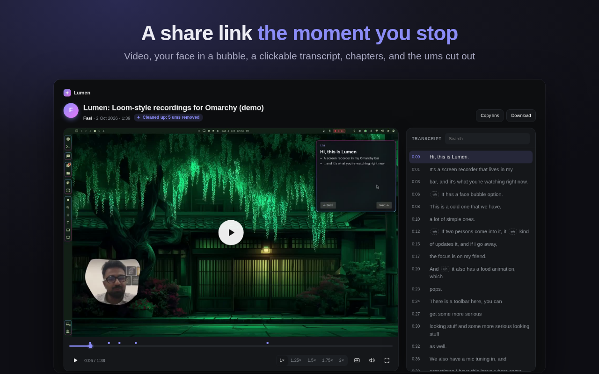

# ✦ Lumen Recorder for Chrome

**Record a tab or your screen with your voice and your face in a bubble, and share it like
a Loom: the link is on your clipboard the moment you stop.** The browser version of
[Lumen](https://github.com/fasi96/lumen), the Loom-style recorder for Omarchy. MIT licensed.

There is no Lumen account and no Lumen server. Recordings are saved as MP4s on your
computer. Share links are optional and live on **your own** Cloudflare account (free up to
10 GB of videos), so the link, the video and the stats are yours.



## What it does

- **Record this tab** in one click, or **any screen or window** through Chrome's picker.
- **Your face in a bubble** that follows your outline (blob, circle or card; plain, glow or
  rainbow outline). In tab recordings it sits on the page; in screen recordings it's drawn
  into the video, and **⧉ Show my camera** floats your camera over every app while you
  record.
- **Sound** for your mic: presets (Natural, Podcast, Crisp, Noisy room, Raw), AI noise
  removal (RNNoise) and loudness that run on your computer, and **Fine-tune by ear** with
  a sample of your own voice. Each mic keeps its own sound.
- A **3‑2‑1 countdown** and a **shortcut** (Alt+Shift+S by default) to start and stop.
- **Every recording saved as an MP4**, written to disk every second, with **crash
  recovery**.

**Share links** (optional, on your own Cloudflare):

- The link is copied when you stop; the video uploads in the background and **resumes**
  if Chrome closes.
- A share page with the video, a **clickable transcript**, **chapters**, captions, hover
  previews and an optional **password**, the same page desktop Lumen makes.
- A **title and summary** written from what you said, and **ums and long pauses cut** out
  of the shared copy (your own recording stays uncut). Both use Cloudflare Workers AI in
  your account and can be switched off.
- **Set up my share site** from the extension in a few minutes (no terminal), or connect
  the one you already have from Lumen on Omarchy (`lumen share connect-code --copy`,
  Lumen 1.3 or newer).

What leaves your computer, and where to: [PRIVACY.md](PRIVACY.md).

## Install

- **Chrome Web Store:** [Lumen Recorder](https://chromewebstore.google.com/detail/lumen-recorder/dlilhiogimgebhhogacgcnanoononbaa), free.
- **From source:**

  ```bash
  git clone https://github.com/fasi96/lumen-chrome && cd lumen-chrome
  git clone https://github.com/fasi96/lumen ../lumen    # the share site's code, for the setup wizard
  npm install
  npm run build                                           # writes the extension to dist/
  ```

  Then open `chrome://extensions`, switch on **Developer mode**, click **Load unpacked**
  and choose `dist/`. A welcome tab asks for the mic (and camera, for the bubble) once.

## Develop

- `npm run watch` rebuilds on every change; reload the extension in `chrome://extensions`.
  Dev builds name the service worker `sw-<n>.js` so Chrome can't keep running an old one.
- Tests, in a throwaway headless Chromium with a fake camera, mic and screen:
  `npm test` (recording, crash recovery, MP4), `npm run test:bubble` (face bubble),
  `npm run test:float` and `npm run test:visible` (the bubble in screen recordings),
  `npm run test:share` (share links against a local copy of the share site, with a
  stand-in for Workers AI), `npm run test:voice` and `npm run test:cleanup` (sound, um
  cutting), `npm run test:setup` (the setup wizard against a fake Cloudflare).
- `npm run release` builds `release/lumen-recorder-<version>.zip` for the Web Store.

How it's put together: a Manifest V3 extension whose recorder runs in an offscreen
document (`extension/src/lib/recorder-core.js`): MediaRecorder writes 1-second WebM chunks
to the extension's private disk, [Mediabunny](https://mediabunny.dev) turns them into an
MP4 without re-encoding, MediaPipe's selfie segmenter finds you for the bubble
(`extension/src/bubble/`), and the mic goes through Web Audio plus one AudioWorklet
(`extension/src/lib/voice.js`). No remote code: everything is in the package.

## Known limits

- On Linux, sound comes only with a **tab**; whole-screen and window recordings get your
  mic but no system sound (a Chrome limitation).
- Chrome's own pages (`chrome://…`, the Web Store) can't be recorded as a tab.
- The MP4 holds VP9 video and Opus audio: plays in Chrome, Firefox, Edge and on Android;
  iPhone/Safari isn't checked yet.
- The face bubble is one person at a time.

## License

MIT, see [LICENSE](LICENSE). Bundled unmodified: Mediabunny (MPL-2.0), MediaPipe Tasks
Vision and its selfie segmenter model (Apache-2.0, see
[extension/vision/NOTICE.md](extension/vision/NOTICE.md)), RNNoise (BSD-3-Clause, built
for WebAssembly by Shiguredo, Apache-2.0, see [extension/audio/NOTICE.md](extension/audio/NOTICE.md)).
